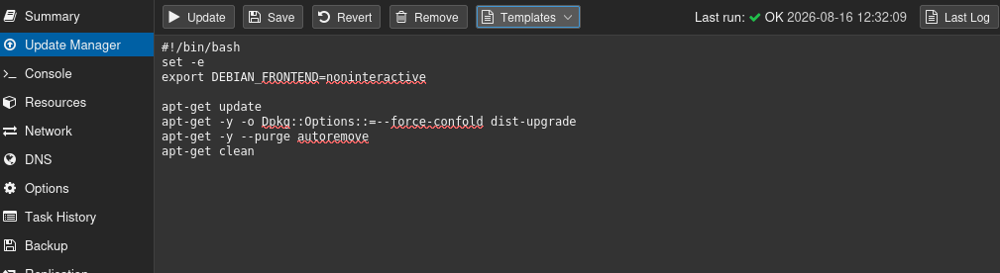
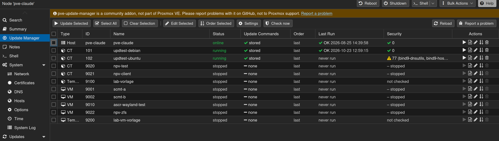
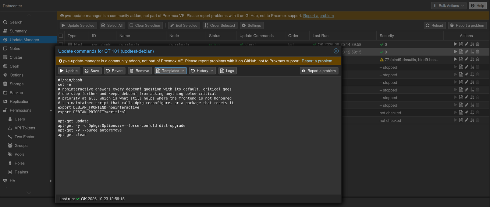

# pve-update-manager

An **Update Manager** tab for Proxmox VE — one per LXC container, one per Linux
VM, one per node, one for the datacenter. You write the update commands, the addon runs them as a
normal Proxmox task and records how each target's last run ended.







## Features

- **Container tab** — a text box with that container's commands and an *Update*
  button. Nothing is generated or guessed from the distribution.
- **VM tab** — the same for a Linux VM, run through the QEMU guest agent, with
  the same snapshots and the same start-and-stop as a container. See [VMs](#vms)
  for what a VM needs.
- **Node tab** — the host and every container on it in one list, with each
  target's last state and a 📄 to its log. Tick some and *Update Selected*, or
  press ▶ / ✎ / 🗑 on a single row.
- **Datacenter tab** — the same list across the whole cluster.
- **Edit Selected** — write the same script to many targets at once; the dialog
  says how many of them already have one.
- **Templates menu** — cluster-wide starting points to paste in, editable and
  resettable.
- **Snapshot before an update**, where the storage can take one, with a
  retention count. On by default, optionally with the guest shut down for it,
  and optionally rolled back to when the update fails. Containers and VMs alike.
- **Script history** — every save is kept with its time and its author, and can
  be put back from the editor. Retention count, default 3.
- **Run logs** — every run keeps its own log per target, readable from the
  editor. Retention count, default 3, `0` keeps none.
- **Update order** — a number per target; lowest first, in serial and parallel
  runs alike. In parallel, everything sharing a number starts at once and the
  next number waits for all of it. *Order Selected* writes one number to a whole
  selection.
- **Failure notifications** — one at the end of a run that had a target fail,
  through Proxmox' own notification system. On by default.
- **Scheduled runs** — a systemd calendar event per node, serial or parallel.
- **Datacenter-wide settings** — write one settings page to every node.
- **Start stopped guests** for their update and stop them again afterwards.
- **Reboot VMs when the update requires it**, off by default.
- **Timeout that kills**, per target, plus an 8 MiB ceiling on what one target
  may write to the task log.
- **Nothing gets switched off mid-update** — the container carries a `mounted`
  config lock and the node holds a systemd shutdown inhibitor for the whole job.
- **A daemon restart does not kill the run** — the worker moves itself into a
  systemd scope of its own before it starts, so a package whose postinst restarts
  `pvedaemon` no longer interrupts a dist-upgrade halfway through.
- **Destroy cleanup** — Proxmox' destroy dialog offers to delete the stored
  commands with the container, ticked by default.

## Install

Download the `.deb` from [Releases](../../releases):

```sh
sudo apt install ./pve-update-manager_*_all.deb
```

Then reload the web interface. `Architecture: all` — nothing is compiled, so the
same file installs on amd64 and arm64.

```sh
sudo apt remove pve-update-manager      # keeps the stored scripts
sudo apt purge  pve-update-manager      # also deletes /etc/pve/pve-update-manager
```

Good to know: the `<script>` tag carries a version derived from the interface
file's contents, so an upgrade invalidates the browser cache by itself.

## Settings

**Node → Update Manager → Settings**, or the same window from the Datacenter tab
for every node at once. Containers have no settings of their own; they follow
the node they run on.

The window has four tabs: **General** (timeout, start and reboot switches,
notification, retention, and the parallel pair of manual runs), **Snapshot**,
**Schedule** and **Security**. The Snapshot tab is shown only on a node where a
guest can be snapshotted; for all nodes at once it is always shown.

| Setting | Default | What |
| --- | --- | --- |
| `snapshot_before` | on | snapshot a container or VM before updating it (a VM: disks only) |
| `snapshot_keep` | 3 | how many of *our* snapshots to keep per guest (1–100) |
| `snapshot_shutdown` | off | shut a running guest down for its snapshot, start it again after |
| `rollback_on_failure` | off | roll the guest back to that snapshot when the update fails |
| `rollback_remove_newer` | on | let that rollback remove snapshots newer than the one it goes back to, when the storage refuses it because of them |
| `notify_failure` | on | notify when a run had a target fail |
| `script_versions` | 3 | saved versions of each target's commands to keep (1–50) |
| `run_logs` | 3 | logs of past runs to keep per target (0–50, 0 keeps none) |
| `parallel_manual` | off | *Update Selected* runs a whole update-order position at once |
| `parallel_manual_max` | 0 | at most this many targets of a position at once (0–100, 0 = no limit) |
| `timeout` | 14400 | seconds before a target's update is killed (10–86400) |
| `start_stopped` | off | start a stopped container or VM for its update, stop it after |
| `reboot_vms` | off | reboot a VM whose update left `/var/run/reboot-required` behind, and wait for its agent |
| `schedule_enabled` | off | run the selected targets on a schedule |
| `schedule_time` | `03:00` | systemd calendar event |
| `schedule_parallel` | off | the same for a scheduled run |
| `schedule_parallel_max` | 0 | the same cap for a scheduled run |
| `schedule_host` | off | include the node's own script in scheduled runs |
| `schedule_vmids` | — | which containers the schedule runs |
| `security_scan` | off | check the targets for pending security updates in the background |
| `security_interval` | 30 | minutes between two checks (5–10080, in steps of 5) |
| `security_parallel` | 4 | targets one check reads at the same time (1–64) |
| `security_targets` | `all` | `all` guests, or only those with an update `script` |
| `security_source` | `configured` | fetch the security lists from each target's own sources and proxy, or from `debian` directly |
| `security_exclude` | — | package patterns never counted, e.g. `linux-image-*` |
| `security_min_severity` | — | react only from `low`, `medium` or `high` up; an unrated fix counts |
| `security_notify` | on | notify when a check finds pending security updates |
| `security_notify_once` | on | about each package of a target only once |
| `security_unfixed_cooldown` | 300 | minutes between two NOT FIXED notifications of a node (0 = every time) |
| `security_install` | off | update a target as soon as a check finds one |
| `security_install_mode` | `script` | what that run executes: the target's `script`, or only the affected packages (`security`) |
| `security_install_vmids` | — | only these guests are updated immediately; empty = every target with pending updates — in mode `script` those with an update script, in mode `security` every guest and the host |
| `security_install_window` | — | only within this daily window, e.g. `06:00-22:00` |
| `security_install_gap` | 60 | no immediate update when the scheduled run is due within this many minutes |
| `security_install_parallel_max` | 1 | immediate updates at the same time (1–64) |
| `security_reboot` | off | restart a guest that left `/var/run/reboot-required` after such an update |

Datacenter-wide saves write every key except `schedule_vmids`, `security_install_vmids` and `last_run`,
which stay per node. The permissions (see *Permissions*) are checked on every
node before any of them is written.

## Snapshots

| Situation | What happens |
| --- | --- |
| storage can snapshot | `updmgr-<date>-<time>` before the run; ours above the retention count are removed after it |
| storage cannot | updated anyway, the log says so |
| snapshot fails | the target fails before the update starts |
| `snapshot_shutdown` on | shut down, snapshotted, started again, then updated |
| `rollback_on_failure` on, update failed | rolled back to that snapshot, and started again if it was running |
| something snapshotted the container during the update | the storage refuses the rollback; with `rollback_remove_newer` on, those snapshots are removed and the rollback goes ahead |

Good to know:

- Capability is asked per guest via Proxmox' own `has_feature('snapshot')`
  — ZFS, LVM-thin, RBD and btrfs qualify, a directory storage does not.
- Only names matching `updmgr-<8 digits>-<6 digits>` are ever removed, and age
  comes from Proxmox' `snaptime`, not from the name.
- A removal that fails leaves PVE's `snapshot-delete` lock and a snapshot in
  state `delete` behind, which blocks the container's next update, backup and
  start. That is detected and undone: the lock is taken back and the snapshot is
  forced out of the config, with a warning that its volume may still be on the
  storage. Only a lock whose value is exactly `snapshot-delete` is ever removed,
  and the row says how many snapshots are still stuck.
- A container that is *already* locked that way when a run starts is repaired
  too, but only once its config has been untouched for ten minutes — a removal
  that is really running writes that file as it goes. A `backup`, `mounted` or
  `migrate` lock is never touched and the target is skipped as before.
- The usual way to get there is a snapshot that is in the container's config but
  no longer on the storage, which a manual rollback or `zfs destroy` outside PVE
  can leave behind.
- `rollback_on_failure` undoes a failed update, and it is off by default because
  it undoes **everything** since the snapshot, not only what the update did -
  anything a service wrote in the meantime goes with it. Only a snapshot this
  addon took in that same run is ever rolled back to, never one somebody made by
  hand. PVE stops the container to roll it back and leaves it stopped, so one
  that was running is started again afterwards; one that was only started for
  its update stays stopped. The row says *rolled back to …* instead of naming a
  snapshot to go back to, because the container is no longer the one the update
  left behind. A rollback that fails says so on the row.
- `rollback_remove_newer` exists because a rollback is not a list of snapshots,
  it is the volume going back: ZFS, classic LVM and qcow2 chains refuse to roll
  back at all while a *newer* snapshot exists (`can't rollback, 'X' is not most
  recent snapshot on 'Y'`), and there is no force to pass on - neither PVE's API
  nor `pct rollback` has one. The usual way to hit it is an auto-snapshot tool
  firing while the update runs. With this on, those snapshots are removed and
  the rollback is tried once more; the run names every one of them in the log.
  Nothing that could have survived is lost - a rollback destroys every snapshot
  newer than the one it goes back to either way, which is exactly why the
  storage refuses. This is the one case in which a snapshot the addon did not
  take is removed: only ones the storage itself named as standing in the way,
  only after a rollback was refused, and never PVE's own replication snapshots,
  which belong to the replication job. Off, such a rollback fails and the
  container stays on the failed update. btrfs and LVM-thin never refuse, so the
  setting does nothing there.
- A worker that is killed - node reboot, out-of-memory - never gives the
  `mounted` lock back, and every later run then skips that container with
  *another task holds the lock*. Where nothing has touched the container for ten
  minutes the row says so and names `pct unlock <vmid>`. The lock is not removed
  automatically: `pct mount` sets the same value, and a container whose rootfs
  is mounted on the host is the last one to write into from a second direction.
- An LXC snapshot never holds memory — that exists for VMs only. With
  `snapshot_shutdown` a running container is stopped first, snapshotted, started
  again and then updated; it ends up running, as it was found. A container that
  was already stopped is not touched by it, and a storage that cannot snapshot
  costs no downtime. If the shutdown or the restart fails, the target fails and
  the update does not run.
- A shutdown that does not finish in 120 s falls back to a hard stop, and the
  log says so — the snapshot is then crash-consistent rather than clean.
- A worker that is killed while the container is down (node reboot, OOM) leaves
  it down. That is the same exposure a `stop`-mode backup has.

## Security check

With `security_scan` on, each node checks its targets for pending security
updates in the background — every `security_interval` minutes, or at once with
**Check now** on the node tab. Nothing is installed by the check itself.

How it works, per node:

1. Each guest's apt sources are read (`/etc/apt/sources.list`,
   `sources.list.d/*.list` and `*.sources`, proxy from `apt.conf`). Every distinct
   security suite among them is downloaded **once**, by apt itself into a private
   directory — signature, checksums and proxy as configured in the guest. The
   node's own apt state is not touched.
2. Each target's `/var/lib/dpkg/status` is **read**, not executed: through a
   `chroot` into a running container (so a symlink inside it cannot point the
   node at its own files), from the root directory of a stopped container where
   that is a directory (ZFS subvolume, `dir` storage — never mounted), and through
   the guest agent for a VM.
3. An installed package older than the version in its security suite is pending.

The result is the **Security** column of the node and datacenter tabs: a count
and the first package names, or a dash and the reason when a target could not
be checked (stopped, no guest agent, no apt, no security source, timed out).
After the lists are fetched, one package file per security source is asked for
(HEAD, through the guest's apt proxy). When it answers 404 or 410 - the lists
are still there but the packages moved, as bullseye-security's did to
archive.debian.org - a target with pending updates from it shows them as
**packages unavailable** with the address on hover, and the notification says
so once. The guest's sources are not changed.

| | |
| --- | --- |
| a guest that hangs | costs its own time limit; the check moves on, and the web interface never waits for it — the API only reads the stored result |
| a guest updating right now | is not read in that round |
| a round still running | the next one is not started on top of it |
| a notification | one per round and node; with `security_notify_once`, each package once per fixed version |
| after every run (button, schedule, immediate update) | the security updates the last check found pending are checked again; one still not installed makes the run **NOT FIXED** — red, but no rollback (that stays for a script that exits non-zero), and a security notification at most every `security_unfixed_cooldown` minutes per node. A guest that cannot be read is asked 3 times, 30 s apart. What the run installed leaves the stored check result at once, so the list does not wait for the next check |
| an immediate update (`security_install`) | a normal run with snapshot and rollback, in its own task; not outside `security_install_window`, not when the scheduled run is due within `security_install_gap` minutes |
| `security_min_severity` | from the Debian security tracker, downloaded by the node through the proxy the guests' apt uses (each distinct one in turn, direct only if a guest has none); an update Debian has not rated yet counts as reaching any threshold |

Results are kept under `/var/lib/pve-update-manager/security` on each node; a
small summary per node lives beside the settings in `/etc/pve`, so every node's
datacenter tab shows every node's numbers.

**Check now** needs `Sys.Console` on the node. Switching the immediate updates
on needs what a run of each covered guest needs, and `root@pam` when they cover
every target (an empty guest list), since that includes the host.

## Script history

Every save that changes something is kept beside the script, named after the
local second it was saved at and the user who saved it — readable without
decoding anything:

```
lxc-10065@2026-08-21-13-21-12-root@pam.conf
```

The **History** button in the editor lists them; picking one puts that text into
the box, and Save stores it.

| | |
| --- | --- |
| how many are kept | `script_versions`, default 3, range 1–50 |
| the newest entry | the text that is stored now |
| a save that changes nothing | writes nothing |
| a text written into the file by hand | kept as a version of its own before a save replaces it — no author, dated by the file |
| restoring | a normal save, and becomes the newest version itself |
| removing the commands | keeps the history |
| `--purge 1`, the destroy tick | deletes it |

```sh
pvesh get /nodes/pve/lxc/101/updatemgr/script/versions
pvesh get /nodes/pve/lxc/101/updatemgr/script/versions/2026-08-21-13-21-12
```

Versions saved before that naming existed are named `*.conf.<epoch>[.<user>]` and
are still listed, still readable and still pruned — they age out through the
retention count on their own. Their identifier is that epoch, which is what the
listing hands back for them.

Good to know: a file edited directly in `/etc/pve` writes no version — what is
recorded is a save that went through the API. And the time in the name is local,
so in the one hour a DST change repeats, a save takes the next free second rather
than overwriting the file already there.

## Run logs

Every run keeps its own log **per target** — one file per target per run, with
the retention count `run_logs`. The **Logs** button — in the editor, and the log
icon on every row — opens them all in one window: the runs on top, what the
selected one printed below, and Proxmox' own task log for it as a button of its
own. There is no view of a single log anywhere; picking which one is what the
window is for.

```
=== pve-update-manager ===
target:   CT 101 (nextcloud)
started:  2026-08-21 13:21:12
finished: 2026-08-21 13:22:05
result:   FAILED (exit 100 after 53s, rolled back to updmgr-20260821-132112)
task:     UPID:pve:00001234:00005678:00000000:ctupdate:101:root@pam:

Reading package lists...
E: Unable to correct problems
```

| | |
| --- | --- |
| where | `/var/lib/pve-update-manager/logs/<target>@<date>-<time>.log` |
| how many | `run_logs`, default 3, `0` keeps none |
| what is in one | the target's own output, plus what the run did around it — the snapshot it took, a container it started, a rollback |
| a skipped target | gets one too, saying why |
| `--purge 1`, the destroy tick | deletes them |

Not in `/etc/pve`, and not a preference: pmxcfs refuses a file over **1 MiB**
(measured: 1024 KiB written, 1025 KiB refused) while one target may write up to
8 MiB, and that filesystem is held in memory on every node and replicated to all
of them. A run happens on the node that owns the target, so its log stays there.

**In a cluster** that means a run log is *not* replicated — but it is still
readable from any node's web interface, because every endpoint here is
`proxyto => 'node'` and the interface addresses the node that owns the target,
not the one the browser is connected to. What is node-local is the *shell* view:
`ls /var/lib/pve-update-manager/logs` on node 1 does not show node 2's logs.

Why keep one when Proxmox already writes a task log: the task log stays on disk
but stops being **reachable**. `/var/log/pve/tasks/index` is renamed to `index.1`
once it passes 50000 bytes — about a thousand tasks — so after a couple of
thousand tasks the entry that points at a log is gone from the task list, and the
*Proxmox Task Log* button in the window finds nothing. There is no logrotate rule
for the files
either, so they simply accumulate. This copy is pruned on purpose instead.

```sh
pvesh get /nodes/pve/lxc/101/updatemgr/logs
pvesh get /nodes/pve/lxc/101/updatemgr/logs/2026-08-21-13-21-12
```

## Update order

A number per target, shown as its own column and set from the row's **Update
order** button. It decides the order of every run, manual and scheduled, serial
and parallel.

| Value | Meaning |
| --- | --- |
| 1…99999 | lower runs first |
| the same number twice | serial: by ascending vmid, host before container. parallel: both at once |
| empty, or 0 | after everything that has a number |

**Order Selected** in the toolbar writes one number to every ticked target at
once — which is how a group that belongs together gets a position of its own. A
single ticked target opens the row's own prompt instead, prefilled with its
number; the box is prefilled for a selection too, but only with a number they
already share. An empty box clears it.

```sh
pvesh set /nodes/pve/lxc/101/updatemgr/order --order 10
pvesh set /nodes/pve/lxc/101/updatemgr/order --order 0    # clear it
pvesh set /nodes/pve/updatemgr/order --order 1            # the host itself
```

In a **parallel** run the number is a position: everything sharing one starts at
once, and the next position does not start until the last target of the previous
one is done. Targets with no number are one final position, all at once — so a
parallel run nobody has given an order to is still fully parallel.

A cap (`parallel_manual_max`, `schedule_parallel_max`; next to the parallel
switch in the settings) limits how many targets of one position run at the same
time; the next starts when one finishes, and the next position still waits for
the whole of this one. Measured before it existed: 36 targets started in the
same second, the node's DNS and proxy containers among them, and the failures
that night were network fetches that went through when retried one at a time.
Giving such infrastructure an earlier position keeps it out of the crowd.

```
position 1 of 3: CT 101 (db)
position 2 of 3: CT 102 (web), CT 103 (web2)     <- both at once
position 3 of 3: CT 110, CT 111, CT 112          <- no number, so last
```

The whole run is one task either way, and in a parallel one every line of output
carries the target that printed it: `[CT 102] Reading package lists...`.

## Notifications

A run that had a target fail sends one notification when the **whole run** is
over — not one per target. It goes through Proxmox' own notification system, so
where it lands is already configured under **Datacenter → Notifications** and
there is no address to enter here. `notify_failure` turns it off.

| | |
| --- | --- |
| severity | `error` |
| metadata | `type=pve-update-manager`, `hostname=<node>` |
| template | `/usr/share/pve-manager/templates/default/pve-update-manager-*.hbs` |

Nothing is sent for a run in which everything worked, and a target that was
*skipped* is not a failure.

One block per failed target, everything on a line of its own:

```
Subject: update manager status (pve.example.com): 1 of 2 update targets failed

1 of 2 update targets failed

Result
======
Succeeded:    1 of 2 targets
Failed:       1 of 2
Skipped:      0 of 2
Running time: 84s

Details
=======
CT 102 (web)
  Failed at:   2026-08-20 03:04:11
  Took:        71s
  Exit code:   100 (the script exited)
  Snapshot:    updmgr-20260820-030300
  Rolled back: no - the snapshot above is still there to go back to
  Also:        nothing else to report

Task
====
UPID:pve:00001234:00005678:00000000:updatemgr:pve:root@pam:
```

`Rolled back` answers three different questions at once — whether the update was
taken back, whether the container came back up, and whether there is still a
snapshot to go back to — because those decide what to do next. `Exit code` says
whether the script exited or the timeout killed it: both are a number, and 124
means two different things. `Also` carries what nothing else does: dropped output,
a container that could not be stopped again, a snapshot that could not be removed.

A matcher can route these on their own:

```sh
pvesh create /cluster/notifications/matchers --name updates \
    --match-field 'exact:type=pve-update-manager' --target <your-target>
```

## Scheduled runs

```
03:00               every day at 03:00
mon..fri 02:30      weekdays only
*/8:00              every eight hours
sat 04:00           once a week
```

```sh
pve-update-manager-schedule status   # the settings, and when they fire next
pve-update-manager-schedule run      # run if due - what the timer does
```

`pve-update-manager.timer` asks every five minutes whether the next occurrence
has passed; the schedule is not encoded in the unit, so a change takes effect
immediately. Due-ness is measured from `last_run`, which is stamped before the
work starts. A run is skipped while any of its targets is still updating.

## Templates

Cluster-wide, editable, and shared by every node. Until something is changed it
is the built-in set; the first change writes the whole set to
`templates.conf`. **Reset to Defaults** deletes that file.

Shipped: apt, apt major release upgrade, apk, pacman, dnf.

```sh
pvesh get    /cluster/updatemgr/templates
pvesh set    /cluster/updatemgr/templates --name 'House style' --script "$(cat tpl.sh)"
pvesh set    /cluster/updatemgr/templates --name 'New name' --script "$(cat tpl.sh)" --oldname 'House style'
pvesh delete /cluster/updatemgr/templates --name 'House style'
pvesh create /cluster/updatemgr/templates/reset
```

File format — one block per entry, script indented by exactly one space, an
empty script line written as a single space:

```
name: Debian / Ubuntu (apt)
 #!/bin/bash
 set -e
 export DEBIAN_FRONTEND=noninteractive
 
 apt-get update
```

Good to know:

- Editing needs `Sys.Modify` on `/`. **Reading is open to every logged-in
  user** — keep credentials and internal hostnames out of a template.
- Reset is `POST templates/reset`, not a `DELETE` with the name left off.
- Once you edit one entry, improved defaults for the others stop arriving until
  you reset.
- Both apt templates pass `--allow-releaseinfo-change` to `apt-get update`, so a
  repository that renamed its suite or codename does not stop the run. It is
  only passed where apt is 1.9 or newer, which is where the option exists.
- The **major release upgrade** template handles both distributions: Ubuntu via
  `do-release-upgrade`, Debian by rewriting the codename in `sources.list` and
  in deb822 `.sources`, then minimal-then-full upgrade. Debian moves **one
  release per run** - bullseye to bookworm, bookworm to trixie - so a bullseye
  container needs two runs to reach trixie; buster and older are refused. Before
  going to trixie it merges `/usr` (`usrmerge`) if the container has not, and
  stops before touching the sources if that did not happen. It does not reboot.
  On Ubuntu, *no new release available* and on Debian *already on trixie* are
  reported as a successful run.

## VMs

A Linux VM is a target like a container: it has a tab, a script, a place in the
update order, a schedule entry and run logs, and it shows up in the node and
datacenter lists. The commands are run through the **QEMU guest agent** - no SSH,
no keys, no network path from the node to the VM.

What a VM needs:

| | |
| --- | --- |
| the guest agent enabled | *Options → QEMU Guest Agent* in the VM, i.e. `agent: 1` in its config |
| `qemu-guest-agent` running inside | without it the target **fails** and the failure notification goes out - a VM that silently never gets updated is the outcome this avoids |
| `sh`, `base64`, `timeout` | coreutils has all three |
| systemd | for the scope described below; without it the run still works and the log warns |

How it runs, and why:

- The agent gives no live output - `guest-exec-status` returns nothing until the
  process has ended, and then everything at once. So the script writes into a
  file in `/var/tmp` inside the VM (mode 0600) and the node reads it every 2
  seconds while it grows; the task log fills line by line as with a container.
  The file is removed afterwards.
- The script runs in a **systemd scope of its own** inside the VM. Whatever the
  agent starts otherwise lives in `qemu-guest-agent.service`, and that unit is
  stopped when the `qemu-guest-agent` package is upgraded - which killed a
  dist-upgrade halfway through dpkg and left the package half configured. Moved
  out, the update runs on; the node notices that the agent was restarted, opens
  the log again where it stopped and learns the exit code from a second file.
- Everything sent to the agent is ASCII: the script travels base64-encoded. One
  non-ASCII character in an agent argument made the agent stop answering, once
  until it was restarted inside the VM. A shebang line with non-ASCII in it is
  refused before anything is sent.
- The time limit is enforced inside the VM by `timeout`, as in a container; the
  node cannot kill a process inside a VM.
- **Nothing gets switched off mid-update**: the VM carries the config lock
  `backup` while it updates, so PVE refuses shutdown, stop and migrate - the
  same mechanism as the container's `mounted`. PVE has no neutral lock value for
  VMs, and `backup` is the chosen trade-off: the interface shows the VM as
  locked by a backup during the update, and a backup job that runs in that time
  **fails** for this VM (`Backup of VM … failed - VM is locked (backup)`, the job
  ends "with errors" and notifies). Schedule backups and updates apart. A VM that already carries a lock - a real backup, a migration - is
  skipped. A worker that is killed mid-update leaves the lock behind;
  `qm unlock <vmid>` clears it.

Snapshots, the rollback and the start-and-stop work as for a container, with the
same settings - see [Snapshots](#snapshots). What is different for a VM:

- The snapshot holds the **disks only**, never the memory. With the agent
  running, Proxmox freezes the guest's filesystems around it (`freeze guest
  filesystem` / `thaw guest filesystem` in the log), so the disks are caught
  consistent; a database mid-transaction is still caught mid-transaction, which
  is what `snapshot_shutdown` is for. A CD-ROM - a cloud-init drive included -
  is not snapshotted and never asked about.
- A rollback brings the VM back **cold**: Proxmox stops it to roll it back, and
  one that was running is booted again afterwards.
- A stopped VM started for its update counts as started once its **guest agent
  answers**, after at most 600 s. One whose agent does not answer is shut down
  again and the target **fails**. Measured on a lab VM from `qm start` to the
  first answer: 54 s, 174 s, and over 300 s after a cold snapshot.
- `qm start` refuses a VM that carries a lock, and the VM carries the update's
  `backup` lock by then, so it is started with `--skiplock` - only ever while the
  lock on it is known to be the update's own.
- `reboot_vms` reboots a VM after a **successful** update when
  `/var/run/reboot-required` exists inside it (Debian and Ubuntu write it for a
  new kernel or libc). The target counts as OK only once the agent answers again;
  a reboot that does not bring the VM back fails the target, and the row says
  *exit 0 …, but the reboot it needed FAILED*. Not rebooted: a VM whose update
  failed, one that was rolled back, and one that was started only for its update
  - that one is shut down again and boots the new kernel next time. Containers
  share the node's kernel and are never rebooted.

## Which shell runs your commands

The first line may be a shebang and picks the interpreter; the default is
`/bin/sh`. The script is passed as a single argument (`sh -c '<script>'`), never
re-parsed by another shell. On the node it runs directly, in a container through
`pct exec` — a stopped container is skipped unless `start_stopped` is on — and in
a VM through the guest agent (see [VMs](#vms)).

## Umlauts, emoji and colour

Scripts are stored as UTF-8 and reach the container as UTF-8. Two things had to
be arranged for that, and one is still not perfect:

| | |
| --- | --- |
| storage | the file is UTF-8 and the API is handed characters, so nothing is encoded twice or written as Latin-1 |
| into the container | the script travels base64-encoded, because `pct exec` replaces every non-ASCII **byte** of an argument with `U+FFFD` |
| terminal colour | escape sequences are removed from the log |

Good to know:

- The base64 needs `base64` in the container. coreutils and busybox both have
  it; where it is missing the script is used as it arrived and the log says so.
- Colour cannot be shown: Proxmox' log viewer html-encodes every line, so an
  escape sequence would appear as `[0;31m`. Stripping them is the only thing
  available without changing Proxmox' own JavaScript.
- **The task viewer still shows non-ASCII wrong** — `ü` for `ü`. The log file
  on disk is correct UTF-8; PVE's own task-log endpoint reads it with `<$fh>`
  and lets the JSON layer encode those bytes a second time. That is upstream of
  this addon, and `cat` on `/var/log/pve/tasks/…` shows the real thing.

## Permissions

| Action | Needs |
| --- | --- |
| see a container's or VM's tab and script | `VM.Audit` on `/vms/<vmid>` |
| edit a container's or VM's script | `VM.Config.Options` on `/vms/<vmid>` |
| run a container's or VM's script | `VM.Console` on `/vms/<vmid>`, plus what the run does with the node's settings: `VM.Snapshot` to snapshot it or remove newer snapshots, `VM.Snapshot` or `VM.Snapshot.Rollback` to roll it back, `VM.PowerMgmt` to start, stop or reboot it |
| see the node tab | `Sys.Audit` on `/nodes/<node>` |
| edit or run the host script | **`root@pam`** — the user itself, not a token; PVE gives a root shell on the node to nobody else |
| see the datacenter tab | `Sys.Audit` or `VM.Audit` somewhere |
| edit templates | `Sys.Modify` on `/` |
| change a node's settings | `Sys.Console` on `/nodes/<node>`, plus what the node then runs unattended: for every scheduled or immediately updated guest what a run of it needs (above), and `root@pam` when the host is scheduled or immediate updates cover every target |
| write settings to every node | the same, on every node |

The run rights follow what Proxmox VE asks for the same actions (`VM.Snapshot`,
`VM.Snapshot.Rollback`, `VM.PowerMgmt`), so an update cannot do to a guest what
its caller could not do by hand. A settings save that changes nothing is not
checked; one that changes anything is checked against everything the node
would then run.

The datacenter list is built from Proxmox' cluster resource index. That index
filters **guests** by `VM.Audit` and returns every **node** whatever the user
may see — it only leaves a node's statistics out — so the node rows are filtered
against `Sys.Audit` here, the same way the node tab does it. The host row is
never picked by *Select All Containers*.

## API

```sh
# a container's commands
pvesh set    /nodes/pve/lxc/101/updatemgr/script --script "$(cat update.sh)"
pvesh get    /nodes/pve/lxc/101/updatemgr/script
pvesh delete /nodes/pve/lxc/101/updatemgr/script
pvesh delete /nodes/pve/lxc/101/updatemgr/script --purge 1   # also the last-run state

# the node's own commands: same three, under /nodes/pve/updatemgr/script

# the saved versions of those commands, and one of them
pvesh get /nodes/pve/lxc/101/updatemgr/script/versions
pvesh get /nodes/pve/lxc/101/updatemgr/script/versions/1755690000

# where a target sits in a run
pvesh set /nodes/pve/lxc/101/updatemgr/order --order 10

# run
pvesh create /nodes/pve/lxc/101/updatemgr/run
pvesh create /nodes/pve/updatemgr/run --vmids 101,102 --host 1

# what is there, and how it last went
pvesh get /nodes/pve/updatemgr/targets
pvesh get /cluster/updatemgr/targets

# settings
pvesh get /nodes/pve/updatemgr/settings
pvesh set /nodes/pve/updatemgr/settings --schedule_enabled 1 --schedule_time 03:00
pvesh get /cluster/updatemgr/settings
pvesh set /cluster/updatemgr/settings --snapshot_before 1 --snapshot_keep 5
```

Good to know:

- `run` returns a UPID; it also lands in the target's `last_upid`, which is what
  the 📄 button opens.
- A container with no script stored starts no task and is recorded as `skipped`.
- So is one whose config is not on this node — it has migrated away. The
  scripts live in `/etc/pve` and are the same everywhere, so it would otherwise be
  found and reported as "not running".
- The node's `run` takes container and VM ids in the same `vmids` list: a vmid is
  unique across both, and the node tells them apart. The per-guest endpoints are
  `/nodes/<node>/lxc/<vmid>/updatemgr/...` and `/nodes/<node>/qemu/<vmid>/updatemgr/...`.
- `run --script ...` stores before running and therefore needs
  `VM.Config.Options` on top of `VM.Console`.
- Storing an empty script is refused; removing is its own operation.
- Removing a script keeps the recorded last run and the history. `--purge 1`
  takes those, the saved versions and the order with it.
- There is no cluster-wide `run`: the UI fires one `POST` per node in parallel.
- A single container goes to its own endpoint, so its task is typed `ctupdate`
  and reads *CT 102 — Update Manager* in the task list; a single VM's is
  `vmupdate`, *VM 200 — Update Manager*.

## Files

| Path | What |
| --- | --- |
| `/etc/pve/pve-update-manager/lxc-<vmid>.conf` | a container's update commands |
| `/etc/pve/pve-update-manager/qemu-<vmid>.conf` | a VM's update commands |
| `/etc/pve/pve-update-manager/node-<node>.conf` | the host's update commands |
| `/etc/pve/pve-update-manager/*@<date>-<time>[-<user>].conf` | a saved version of those commands |
| `/etc/pve/pve-update-manager/*.order` | that target's place in a run |
| `/etc/pve/pve-update-manager/*.state` | how that target's last run ended |
| `/etc/pve/pve-update-manager/settings-<node>.conf` | that node's settings |
| `/etc/pve/pve-update-manager/templates.conf` | the Templates menu, once changed |
| `/usr/share/pve-manager/js/pve-update-manager.js` | the web interface code |
| `/usr/share/pve-manager/templates/default/pve-update-manager-*.hbs` | the text of the failure notification |
| `/usr/share/perl5/PVE/UpdateManager/*.pm` | the API |
| `/usr/sbin/pve-update-manager-hooks` | applies / removes the integration |
| `/usr/sbin/pve-update-manager-schedule` | what the timer runs |
| `/usr/lib/systemd/system/pve-update-manager.timer` | five-minute due check |
| `/var/lib/pve-update-manager/logs/*@<date>-<time>.log` | the kept log of one run of one target |
| `/var/lib/pve-update-manager/backup/` | copies taken before editing |

Everything under `/etc/pve` is cluster-replicated and plain text:

```sh
$ cat /etc/pve/pve-update-manager/lxc-102.state
exit=0
finished=1786817301
started=1786817167
state=ok
upid=UPID:pve:000798A0:011ACA05:6A80AA7B:updatemgr:pve:root@pam:
```

Good to know: the state file is not the task log. Task logs rotate away, this
does not.

## How it hooks into Proxmox

Four one-line edits, idempotent and reversible:

| File | Line added |
| --- | --- |
| `/usr/share/pve-manager/index.html.tpl` | a versioned `<script>` tag after `pvemanagerlib.js` |
| `/usr/bin/pvedaemon` | `BEGIN { eval { require PVE::UpdateManager::Inject; }; }` |
| `/usr/bin/pveproxy` | the same |
| `/usr/bin/pvesh` | the same |

```sh
pve-update-manager-hooks status    # hooked / plain, per file
pve-update-manager-hooks apply     # (re)apply and reload the daemons
pve-update-manager-hooks revert    # remove and reload
```

Good to know:

- `pvemanagerlib.js` is **not** patched. The tabs come from an override of
  `PVE.panel.Config.initComponent`, the API from `register_method({subclass})`
  at daemon startup, the destroy tick from the `additionalItems` and
  `apiCallDone` hooks of `PVE.window.SafeDestroyGuest`.
- All three Perl entry points need the line, `pvesh` included — without it
  `pvesh` answers *no handler defined* while the web interface works.
- It must be `BEGIN`, above the entry-point `use`. `PERL5OPT` is no substitute:
  `pvedaemon` and `pveproxy` run under `-T`, and taint mode ignores it.
- A dpkg trigger re-applies everything after a `pve-manager` upgrade.
- Before a Perl file is edited a copy goes to
  `/var/lib/pve-update-manager/backup/`, and the result must pass `perl -Tc` or
  the backup goes straight back.

## Building

```sh
make check     # shellcheck, perl -c against stubs, node --check
make test      # the suite: unit tests plus the hook script against fixtures
make deb       # deb-out/pve-update-manager_<version>_all.deb
```

The tests need no Proxmox — the Perl modules run against stubs in `tests/stubs`,
and the hook script runs for real against copies of a real `index.html.tpl`, a
taint-mode `pvedaemon` and a non-taint `pvesh` in a tmpdir.

The web interface is written as parts under `js/src/NN-name.js` and joined in
that order into `js/pve-update-manager.js` by `make` — the one file the package
installs and the browser loads. That file is build output and not tracked: edit
the parts. A test run started by hand (`node tests/js/…`) reads whatever bundle
the last `make` left behind.

No file goes over 1000 lines; `make test` refuses one that does (500 is the aim).

## Licence

AGPL-3.0-or-later, see [LICENSE](../LICENSE) — the same licence Proxmox VE uses.
This addon imports Proxmox' Perl modules and subclasses `PVE::RESTHandler`, so
it is a derivative of AGPL-licensed code and cannot be more permissive.

### Copyright

```
pve-update-manager - an Update Manager tab for Proxmox VE
Copyright (C) 2026 Lukas

This program is free software: you can redistribute it and/or modify it under
the terms of the GNU Affero General Public License as published by the Free
Software Foundation, either version 3 of the License, or (at your option) any
later version. See the LICENSE file for the full text.
```

That notice is what a fork has to keep. It lives here rather than at the top of
`LICENSE`, because GitHub only recognises a licence when that file holds the
verbatim upstream text — a prepended header makes it report "Unknown license".
